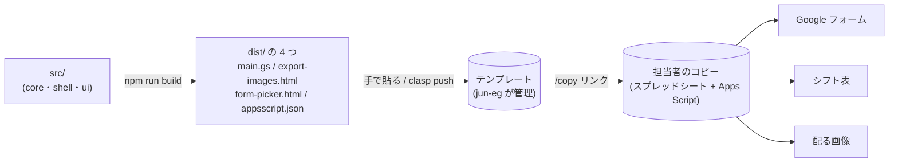
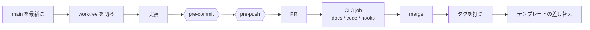
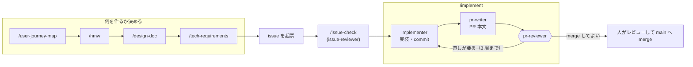

<h1 align="center">学祭シフト（school-festival-shift）</h1>

<p align="center">
  学祭の模擬店のシフトを、Google スプレッドシートの上で仮完成まで自動で組む仕組み
</p>

<p align="center">
  
  
  
  
  
  
  
  
  
  
  
</p>

---

## 概要

### 誰の・何を・どうするシステム化か

| | |
| --- | --- |
| 誰の | 毎年入れ替わる模擬店のシフト担当者。引き継ぎは前年の表 1 枚と LINE の短い説明だけ |
| 何を | 検便・学年・時間の条件と、準備・片付けのルールを満たす割り当て。3〜6 時間かけ、20 回ほどやり直していた |
| どうする | 条件と希望をデータとして外に出し、条件を満たす仮完成を 1 案つくる。担当者は「白紙から組む人」から「例外だけ直す人」になり、手作業を 5〜15 分にする |

### なぜこの方法・この技術スタックか

| 選んだもの | 理由 |
| --- | --- |
| 仮完成 ＋ 手直し | 担当者の理想が「仮完成を 5〜15 分直す」だった。見える化や制約チェッカーでは時間が縮まなかった |
| スプレッドシート ＋ Apps Script | 担当者がやるのはコピー 1 回と承認 1 回だけ。インストール不要で、氏名と学籍番号は担当者の Google アカウントの外へ出ない |
| 自前の貪欲法 | 解なしで止まらず、足りない所を名指しで返せる。39 人・88 枠なら十分 |
| TypeScript ＋ esbuild ＋ node:test | シートに触らないコアと触る殻を分け、実機なしで手元と CI で検査できる |

### エンジニアのいない年が続いても受け継がれる

サークルに毎年、情報系の学部生がいるとは限らず、作った本人も卒業する。そこで次の 2 つを満たす形にした。

- **誰も保守しなくても動き続ける**: スクリプトはテンプレートのコピーで担当者に渡り、外部のサーバ・API・課金に頼らない。年の切り替えもメニュー 1 つで済む
- **何年か空いても、いつか来たエンジニアが再開発できる**: 決めた理由は issue と ADR に、仕様は型と検査に残し、文書が古くなれば機械が止める

背景と決めたことは [ジャーニーマップ](docs/journey/作る側.md) → [HMW](docs/hmw.md) → [Design Doc](docs/design-doc.md) → [技術の要件定義](docs/tech-requirements.md) の要約で辿れる（一覧は [`docs/README.md`](docs/README.md)）。

## 構成



コアと殻の境目、テンプレートの作り方と貼り替え方は [`src/README.md`](src/README.md) にある。

## 開発の流れ



worktree の切り方は [`CLAUDE.md`](CLAUDE.md) にある。

### Claude Code の skill と agent



定義は [`.claude/skills/`](.claude/skills/) と [`.claude/agents/`](.claude/agents/) にある。

## 開発環境

守る約束を人に覚えさせず、破れば機械が止める。

| 仕組み | 止めるもの |
| --- | --- |
| [pre-commit](.githooks/pre-commit) | 秘密の混入・切れたリンク・古い要約・型・lint・テスト・ビルドの失敗 |
| [pre-push](.githooks/pre-push) | 根拠の無い検査の削除・緩和（Claude が差分を読む） |
| [CI](.github/workflows/ci.yml) | 同じ検査を PR でも回す |
| [Claude Code の柵](.claude/README.md) | force-push・`main` への push・`main` 向け PR の merge |
| [Dependabot](.github/dependabot.yml) | 依存の放置（月 1 で PR） |

### 文書は人用と AI 用に分け、古くなったら止める

- 原本（AI 用）は [`docs/agent/`](docs/agent/)、要約（人用）は [`docs/`](docs/) に置く
- 要約に原本のハッシュを刻み、原本だけ直すと pre-commit と CI が止める
- 同じことを 2 か所に書かず、リンクで渡す

規約は [`docs/README.md`](docs/README.md) にある。

### 実機の E2E も回せる

`npm run e2e` で、実機の Apps Script をテンプレート作成から「来年用に空にする」まで無人で通し、手元の検査と同じ結果になるかを見る。
GCP プロジェクトと clasp が要るので任意で、CI では回さない（→ [`e2e/README.md`](e2e/README.md)）。

## 技術スタック

| レイヤー | 技術 |
| --- | --- |
| 実行環境 | Google Apps Script ／ 開発は Node.js |
| 言語 | TypeScript |
| ビルド | esbuild |
| lint と書式 | Biome ／ EditorConfig |
| 型 | `tsc --noEmit` |
| テスト | `node:test` |
| E2E | clasp ＋ Apps Script Execution API（任意） |
| CI | GitHub Actions |
| 依存の更新 | Dependabot |
| 開発の柵 | git hooks ／ Claude Code の hook |
| 配布 | スプレッドシートのテンプレート |

## ディレクトリ構成

```
.
├── src/
│   ├── core/      # シートに触らない純粋な関数
│   ├── shell/     # SpreadsheetApp に触る殻
│   └── ui/        # ダイアログの HTML
├── scripts/       # 判定・文書の検査・秘密の検査
├── e2e/           # 実機の E2E（任意）
├── docs/
│   ├── agent/     # 原本（AI 用）
│   └── *.md       # 要約（人用）
├── .claude/       # Claude Code の設定・hook・skill・agent
└── .githooks/     # pre-commit・pre-push
```

## コマンド

| コマンド | 何をするか |
| --- | --- |
| `npm ci` | 開発の道具を入れる |
| `npm test` | 型を検査し、テストを全部回す |
| `npm run typecheck` | 型だけを検査する |
| `npm run lint` / `format` | Biome で検査する / 書式を直す |
| `npm run build` | 貼る物を `dist/` に出す |
| `npm run 判定` | M1〜M4 の判定と検算を回す |
| `npm run e2e` | 実機の E2E を回す（任意） |

## 環境構築

```
.node-version の Node を入れる（22.18 以上）
npm ci
git config core.hooksPath .githooks
npm test
```

- pre-push には `claude`（Claude Code）が PATH に要る
- `.env`・トークンは commit しない（pre-commit の秘密の検査が止める）

## トラブルシューティング

| 症状 | 直し方 |
| --- | --- |
| 要約の検査で止まる | 要約を書き直して刻み直す（[`docs/README.md`](docs/README.md) の「止まったときの直し方」） |
| リンクの検査で止まる | 名指しされたリンクを直す |
| pre-push が `claude` が無いと止まる | Claude Code を入れる |
| pre-push が検査の緩和で止まる | 同じ push に実装の変更を入れるか、issue の「決めたこと」に根拠を書く |
| Claude のコマンドが柵で止まる | 拒否メッセージを読む。抜け方は [`.claude/README.md`](.claude/README.md) の「例外」 |
| `npm run e2e` が止まる | [`docs/e2e-症状と対処.md`](docs/e2e-症状と対処.md) |
| メインの checkout で「must be run in a work tree」 | `git --git-dir=.git config core.bare false`（[#354](https://github.com/jun-eg/school-festival-shift/issues/354)） |
