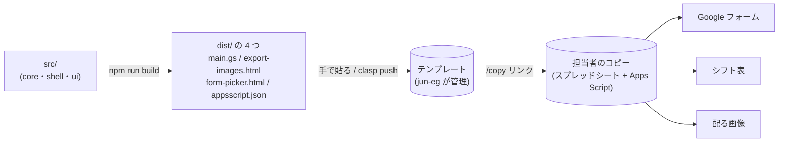
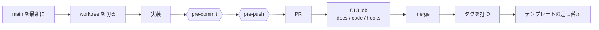

<h1 align="center">学祭シフト（school-festival-shift）</h1>

<p align="center">
  学祭の模擬店のシフトを、Google スプレッドシートの上で仮完成まで自動で組む仕組み
</p>

<p align="center">
  
  
  
  
  
  
  
  
  
  
  
</p>

---

## 概要

### 誰の・何を・どうするシステム化か

- **誰の**: 学祭の模擬店で、毎年入れ替わるシフト担当者。引き継がれるのは前年の表 1 枚と LINE の短い説明だけで、技術力は年で大きく振れる。シフトに入るメンバーは、体験を変えない側である
- **何を**: 割り当て。検便・学年・時間の条件で候補が枯れる探索と、頭の中にしかない準備・片付けのルールで、3 日に分けて 3〜6 時間、20 回ほどやり直していた
- **どうする**: 条件と希望をデータとして外に出し、条件を満たす仮完成を 1 案つくる。担当者は「白紙から組む人」から「例外だけ直す人」になり、手作業を 5〜15 分にする

### なぜこの方法・この技術スタックか

- **仮完成と手直し（全自動にしない）**: 担当者が語った理想が「仮完成を手で 5〜15 分直す」だった。見える化と制約チェッカーは前年に試して、時間が縮まなかった
- **Google スプレッドシート ＋ Apps Script（Web アプリにしない）**: 担当者に要求してよいのは入力だけである。すでに触れているフォームとスプレッドシートの上なら、テンプレートのコピー 1 回と権限承認 1 回で始められ、インストールも新しい画面も要らない。氏名と学籍番号は担当者の Google アカウントの外へ出ない。集める口（Google フォーム）と配る口（LINE ノートに貼る画像）も動かさない
- **自前の決定的な貪欲法（外部ソルバーを使わない）**: 解なしで止まらず、足りない所を名指しで返す必要がある。規模は 39 人・88 枠と小さい
- **作った人の手を離れても動き続ける**: 来年・再来年の組織にエンジニアがいる保証は無い。だから動かすのに人の保守が要らない形にした。スクリプトはテンプレートのコピーに入って担当者ごとに渡り、実行時に読む外部のサーバ・API・ライブラリ・課金は無い。依存が切れたり誰かが更新を止めたりしても、配った物は止まらない。年の切り替えも、メニューの「来年用に空にする」1 つで済む
- **いつか来るエンジニアに、リポジトリだけで引き継げる**: 口で引き継がれる前提を置かない。何をなぜ決めたか・何を却下したかは issue と ADR に、仕様は型と検査に、手順は README に残す。そのうえで、文書が古くなったら機械が止める（下の「開発環境」）。担当者のコピーに載る版（タグ）から、どの commit かも引ける
- **TypeScript ＋ esbuild ＋ node:test**: シートに触らない純粋なコアと、`SpreadsheetApp` に触る殻を分け、実機なしで型と判定を手元と CI で回すためである。前年までの作り込みは翌年に渡らなかったが、それを引き継げるコードにする。esbuild で `dist/` の 4 つに束ね、貼る物を減らし、版をタグで読めるようにする
- **Biome・GitHub Actions・Dependabot・Claude Code**: 開発する側だけの道具である。担当者に要求するものは 0 のまま

上流は [ジャーニーマップ（作る側）](docs/journey/作る側.md)・[ジャーニーマップ（入る側）](docs/journey/入る側.md) → [HMW](docs/hmw.md) → [Design Doc](docs/design-doc.md) → [技術の要件定義](docs/tech-requirements.md) の順に辿れる。一覧は [`docs/README.md`](docs/README.md)。

## 構成

ソースは `src/` に置き、`npm run build` が `dist/` の 4 つに束ねる。テンプレートのスクリプトに貼り替えると、次にコピーした担当者に届く。



- **コア**はシートに触らない純粋な関数、**殻**は `SpreadsheetApp` に触る部分である。境目と段の中身は [`src/README.md`](src/README.md) が持つ
- テンプレートの作り方と、コードを直したあとの貼り替えの手順も [`src/README.md`](src/README.md) が持つ

## 開発の流れ



- worktree の切り方は [`CLAUDE.md`](CLAUDE.md) が持つ。`main` は手元にそのまま残る
- merge のあとに、タグを打って貼り替えるまでが 1 周である

## 開発環境

**人が読んで守る約束ではなく、守れていなければ機械が止める形にしてある。** 次の担当が手順を知らなくても、壊す前に止まる。

| 仕組み | 何を止めるか | 中身の持ち主 |
| --- | --- | --- |
| pre-commit | 秘密の混入・切れたリンク・古い要約・型・lint・テスト・ビルドが落ちる commit | [`.githooks/pre-commit`](.githooks/pre-commit) |
| pre-push | 検査を消す・緩める差分に根拠が無い push（差分があるときだけ Claude の `test-diff-reviewer` が読む） | [`.githooks/pre-push`](.githooks/pre-push) |
| CI（3 job） | 同じ検査を PR でも回す。手元の hook を切っても merge 前に止まる | [`.github/workflows/ci.yml`](.github/workflows/ci.yml) |
| Claude Code の柵 | force-push・push 済みの rebase・`main` への push・`main` 向け PR の merge | [`.claude/README.md`](.claude/README.md) |
| Dependabot | 依存が古いまま放置されること（npm と Actions に月 1 で PR） | [`.github/dependabot.yml`](.github/dependabot.yml) |

### 文書は、人が読む物と AI が読む物を分け、古くなったら止める

- **原本（AI 用）は [`docs/agent/`](docs/agent/)、人が読む要約は [`docs/`](docs/) 直下に同じ名前で置く。** 原本は根拠・却下案・出典まで全部持ち、要約は 40 行（ADR は 10 行）に収める
- **要約の先頭に原本のハッシュを刻む。** 原本を直して要約を見直していなければ、[`scripts/要約の検査.mjs`](scripts/要約の検査.mjs) が pre-commit と CI で落とす。長さの上限も同じ検査が見る
- **リンクが切れたら [`scripts/リンクの検査.mjs`](scripts/リンクの検査.mjs) が落とす。**
- **同じことを 2 か所に書かない。** 1 つの事実には持ち主のファイルが 1 つあり、ほかはリンクで渡す。二重に持つと片方が古くなるからである
- **判定が動いたら ADR に残す**（[`docs/agent/ADR/`](docs/agent/ADR/)）。issue は上段が人間用、下段の `<details>` に根拠と却下案を畳む

書き方の規約は [`docs/README.md`](docs/README.md)、ADR の規約は [`docs/agent/ADR/README.md`](docs/agent/ADR/README.md) が持つ。

### 実機の E2E も回せる

- **`npm run e2e` 1 つで、実機の Apps Script を無人で通しで回せる。** 検証用スプレッドシートに `clasp push` し、Apps Script Execution API で テンプレートを作る → モック投入 → 構造の検証 → 生成 → 画像 → フォームを作る → 来年用に空にする を順に呼ぶ
- **見るのは「手元の検査と同じ入力で、同じ結果になるか」である。** 実機の結果を `node:test` で手元の検査の出力と突き合わせ、生成の所要時間も毎回出す
- **任意である。** GCP プロジェクトと clasp のログインが要るので、CI と `npm test` には入れない。用意するものと流れは [`e2e/README.md`](e2e/README.md)、画面でしか分からないものは [`src/real-device-log.md`](src/real-device-log.md) が持つ

### Claude Code の skill と agent

- **アイデア出しから要件定義まで**: `/user-journey-map` → `/hmw` → `/design-doc` → `/tech-requirements`。インタビューの質問は `/interview-questions`
- **issue から PR まで**: `/issue-check` が解決策の妥当性を見て、`/implement` が実装・PR・レビュー・修正を回す（`main` への merge は人がやる）

定義は [`.claude/skills/`](.claude/skills/) と [`.claude/agents/`](.claude/agents/) にある。

## 技術スタック

| レイヤー | 技術 |
| --- | --- |
| 実行環境 | Google Apps Script（担当者のスプレッドシートに付くスクリプト）／ 開発は Node.js |
| 言語 | TypeScript |
| ビルド | esbuild（`dist/` の 4 つに束ねる） |
| lint と書式 | Biome ／ EditorConfig |
| 型 | `tsc --noEmit` |
| テスト | `node:test`（`src/`・`scripts/`・`e2e/` の `*.test.*`） |
| E2E | 実機のスプレッドシートで回す任意の 1 本（[`e2e/README.md`](e2e/README.md)） |
| CI | GitHub Actions（`docs`・`code`・`hooks` の 3 job） |
| 依存の更新 | Dependabot（月 1） |
| 開発の柵 | git hooks（`.githooks/`）／ Claude Code の hook（`.claude/`） |
| 配布 | Google スプレッドシートのテンプレート ＋ clasp |

## ディレクトリ構成

```
.
├── src/
│   ├── core/            # シートに触らない純粋な関数（段・シートの定義・フォームの定義）
│   ├── shell/           # SpreadsheetApp に触る殻（シートの読み書き・メニュー・フォーム作成）
│   └── ui/              # ダイアログの HTML（画像の書き出し・名簿の選択）
├── scripts/             # 判定・文書の検査・秘密の検査（→ scripts/README.md）
├── e2e/                 # 実機の E2E（任意。CI では回さない）
├── docs/
│   ├── agent/           # 原本（AI 用）。ADR・Design Doc・要件定義・画面の記録
│   └── *.md             # 人が読む要約（原本から書く。手で直さない）
├── .claude/             # Claude Code の設定・hook・skill・agent
└── .githooks/           # pre-commit・pre-push
```

## コマンド

| コマンド | 何をするか |
| --- | --- |
| `npm ci` | 開発者の道具を入れる |
| `npm test` | 型を検査し、`*.test.*` を全部回す |
| `npm run typecheck` | `tsc` で型だけを検査する |
| `npm run lint` | Biome で検査する |
| `npm run format` | Biome で書式を直す |
| `npm run build` | Apps Script に貼る物を `dist/` に出す |
| `npm run 判定` | M1〜M4 の判定と検算を回す |
| `npm run e2e` | 実機の E2E を回す（任意） |

## 環境構築

```
.node-version の Node を入れる（22.18 以上）
npm ci
git config core.hooksPath .githooks
npm test
```

- `npm ci` が入れるのは開発者の道具だけで、担当者に要求するものは 0 のままである。hook が npm scripts を呼ぶので、hook より先に入れる
- `git config core.hooksPath .githooks` は clone ごとに 1 回。これで pre-commit と pre-push が走る
- pre-push には `claude`（Claude Code）が PATH に要る。無ければ入れ方を出して止まる
- E2E（`npm run e2e`）は任意である。CI でも `npm test` でも回さず、GCP プロジェクトも `clasp` のログインも要求しない。やるなら [`e2e/README.md`](e2e/README.md) を読む
- トークン・OAuth クライアントの JSON・`.env` は commit しない。`.gitignore` が名指しし、pre-commit の秘密の検査が中身を止める

## トラブルシューティング

| 症状 | 直し方 |
| --- | --- |
| pre-commit が要約の検査で止まる | 原本を直して要約を見直していない。[`docs/README.md`](docs/README.md) の「止まったときの直し方」で書き直し、刻み直す |
| pre-commit がリンクの検査で止まる | 名指しされたリンクの先を直す |
| pre-push が `claude` が無いと止まる | Claude Code を入れる。承知で抜けるなら人が `git push --no-verify` |
| pre-push が検査を緩める差分で止まる | 同じ push に実装の変更を入れるか、issue の「決めたこと」に根拠を書く |
| Claude のコマンドが柵で止まる | 止まった理由は拒否メッセージにある。抜け方は [`.claude/README.md`](.claude/README.md) の「例外」 |
| `npm run e2e` が実機で止まる | [`docs/e2e-症状と対処.md`](docs/e2e-症状と対処.md) |

### メインの checkout で「must be run in a work tree」が出たとき

メインの checkout の `.git/config` に `bare = true` が書かれている（検査の中の `git init` が、外から渡された `GIT_DIR` を引き継いだ跡。[issue #354](https://github.com/jun-eg/school-festival-shift/issues/354)）。メインの checkout で次を打つと直る。

```
git --git-dir=.git config core.bare false
```

検査・ビルドの git は [`scripts/git-env.mjs`](scripts/git-env.mjs) で `GIT_*` を落として呼ぶ。pre-commit は終わりに `core.bare` が `true` なら止まり、同じ直し方を言う。
