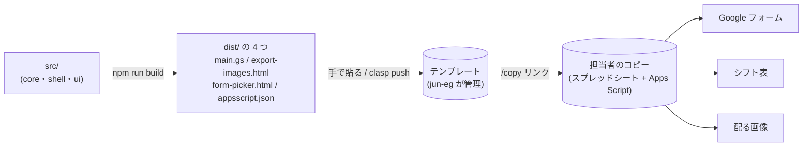
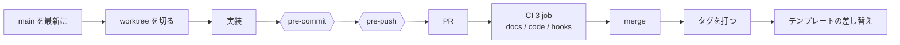

<h1 align="center">学祭シフト（school-festival-shift）</h1>

<p align="center">
  学祭の模擬店のシフトを、Google スプレッドシートの上で仮完成まで自動で組む仕組み（開発する人の入口）
</p>

<p align="center">
  
  
  
  
  
  
  
  
  
  
  
</p>

---

**ここは入口である。** シフトを作る担当者の手順は [`README.md`](README.md) が持つ。

## 概要

### 誰の・何を・どうするシステム化か

- **誰の**: 学祭の模擬店で、毎年入れ替わるシフト担当者。引き継がれるのは前年の表 1 枚と LINE の短い説明だけで、技術力は年で大きく振れる。シフトに入るメンバーは、体験を変えない側である
- **何を**: 割り当て。検便・学年・時間の条件で候補が枯れる探索と、頭の中にしかない準備・片付けのルールで、3 日に分けて 3〜6 時間、20 回ほどやり直していた
- **どうする**: 条件と希望をデータとして外に出し、条件を満たす仮完成を 1 案つくる。担当者は「白紙から組む人」から「例外だけ直す人」になり、手作業を 5〜15 分にする

### なぜこの方法・この技術スタックか

- **仮完成と手直し（全自動にしない）**: 担当者が語った理想が「仮完成を手で 5〜15 分直す」だった。見える化と制約チェッカーは前年に試して、時間が縮まなかった
- **Google スプレッドシート ＋ Apps Script（Web アプリにしない）**: 担当者に要求してよいのは入力だけである。すでに触れているフォームとスプレッドシートの上なら、テンプレートのコピー 1 回と権限承認 1 回で始められ、インストールも新しい画面も要らない。氏名と学籍番号は担当者の Google アカウントの外へ出ない。集める口（Google フォーム）と配る口（LINE ノートに貼る画像）も動かさない
- **自前の決定的な貪欲法（外部ソルバーを使わない）**: 解なしで止まらず、足りない所を名指しで返す必要がある。規模は 39 人・88 枠と小さい。外から読むものが無いので、年によって止まることもない
- **TypeScript ＋ esbuild ＋ node:test**: シートに触らない純粋なコアと、`SpreadsheetApp` に触る殻を分け、実機なしで型と判定を手元と CI で回すためである。前年までの作り込みは翌年に渡らなかったが、それを引き継げるコードにする。esbuild で `dist/` の 4 つに束ね、貼る物を減らし、版をタグで読めるようにする
- **Biome・GitHub Actions・Dependabot・Claude Code**: 開発する側だけの道具である。担当者に要求するものは 0 のまま

上流は [ジャーニーマップ（作る側）](docs/journey/作る側.md)・[ジャーニーマップ（入る側）](docs/journey/入る側.md) → [HMW](docs/hmw.md) → [Design Doc](docs/design-doc.md) → [技術の要件定義](docs/tech-requirements.md) の順に辿れる。

## 構成

ソースは `src/` に置き、`npm run build` が `dist/` の 4 つに束ねる。テンプレートのスクリプトに貼り替えると、次にコピーした担当者に届く。



- **コア**はシートに触らない純粋な関数、**殻**は `SpreadsheetApp` に触る部分である。境目と段の中身は [`src/README.md`](src/README.md) が持つ
- 貼り替えの手順は下の「コードを直したら、テンプレート側のスクリプトを差し替える」を読む

## 開発の流れ



- worktree の切り方は [`CLAUDE.md`](CLAUDE.md)、hook が回す検査の中身は [`.githooks/pre-commit`](.githooks/pre-commit) と [`.github/workflows/ci.yml`](.github/workflows/ci.yml)、実行前の柵は [`.claude/README.md`](.claude/README.md) が持つ
- merge のあとに、タグを打って貼り替えるまでが 1 周である（下の「コードを直したら、テンプレート側のスクリプトを差し替える」）

## 技術スタック

| レイヤー | 技術 |
| --- | --- |
| 実行環境 | Google Apps Script（担当者のスプレッドシートに付くスクリプト）／ 開発は Node.js |
| 言語 | TypeScript |
| ビルド | esbuild（`dist/` の 4 つに束ねる） |
| lint と書式 | Biome ／ EditorConfig |
| 型 | `tsc --noEmit` |
| テスト | `node:test`（`src/`・`scripts/`・`e2e/` の `*.test.*`） |
| E2E | 実機のスプレッドシートで回す任意の 1 本（[`e2e/README.md`](e2e/README.md)） |
| CI | GitHub Actions（`docs`・`code`・`hooks` の 3 job） |
| 依存の更新 | Dependabot（月 1） |
| 開発の柵 | git hooks（`.githooks/`）／ Claude Code の hook（`.claude/`） |
| 配布 | Google スプレッドシートのテンプレート ＋ clasp |

## ディレクトリ構成

```
.
├── src/
│   ├── core/            # シートに触らない純粋な関数（段・シートの定義・フォームの定義）
│   ├── shell/           # SpreadsheetApp に触る殻（シートの読み書き・メニュー・フォーム作成）
│   └── ui/              # ダイアログの HTML（画像の書き出し・名簿の選択）
├── scripts/             # 判定・文書の検査・秘密の検査（→ scripts/README.md）
├── e2e/                 # 実機の E2E（任意。CI では回さない）
├── docs/
│   ├── agent/           # 原本（AI 用）。ADR・Design Doc・要件定義・画面の記録
│   └── *.md             # 人が読む要約（原本から書く。手で直さない）
├── .claude/             # Claude Code の設定・hook・skill・agent
└── .githooks/           # pre-commit・pre-push
```

## コマンド

| コマンド | 何をするか |
| --- | --- |
| `npm ci` | 開発者の道具を入れる |
| `npm test` | 型を検査し、`*.test.*` を全部回す |
| `npm run typecheck` | `tsc` で型だけを検査する |
| `npm run lint` | Biome で検査する |
| `npm run format` | Biome で書式を直す |
| `npm run build` | Apps Script に貼る物を `dist/` に出す |
| `npm run 判定` | M1〜M4 の判定と検算を回す |
| `npm run e2e` | 実機の E2E を回す（任意） |

---

## 何を作っているかは `docs/` の要約を読む

**ジャーニーマップ・HMW・Design Doc・技術の要件定義・ADR の要約は、[`docs/README.md`](docs/README.md) の一覧から辿る。**
**要約は原本（`docs/agent/`）から Claude が書いたもので、手で直さない。** 原本へは要約の先頭のリンクで 1 クリックで行ける。

## commit の前に回る検査を有効にする

**clone したら `npm ci` を回し（hook が npm scripts を呼ぶ）、続けて 1 回だけ**、git hooks の置き場をリポジトリの中に向ける。

```
git config core.hooksPath .githooks
```

**これで commit のたびに [`.githooks/pre-commit`](.githooks/pre-commit) が走り、落ちる状態の commit は止まる**
（何を回すかは hook を読む。写さない）。**同じ検査が PR でも回る**（[`.github/workflows/ci.yml`](.github/workflows/ci.yml)）。
**止まったときの直し方は [`docs/README.md`](docs/README.md) の「古さの check」。**

**同じ設定で `git push` の前に [`.githooks/pre-push`](.githooks/pre-push) も走る。** 検査ファイル・検査を弱める設定（`package.json` の test 系 script、`ci.yml` の test の step）に差分が無い push は、何も呼ばずに通る（1 秒未満）。
差分があるときだけ `claude -p --agent test-diff-reviewer` が差分を読み、検査を消す・緩める変更に根拠（同じ push の実装の変更、issue の「決めたこと」）が無ければ止める。
**`claude`（Claude Code）が PATH に要る。** 無ければ入れ方を出して止まる。**人が承知で抜けるのは `git push --no-verify` だけ**（Claude には [`guard-bash`](.claude/README.md) が打たせない）。CI では回さない。

### メインの checkout で「must be run in a work tree」が出たとき

**メインの checkout の `.git/config` に `bare = true` が書かれている**（検査の中の `git init` が、外から渡された `GIT_DIR` を引き継いだ跡。[issue #354](https://github.com/jun-eg/school-festival-shift/issues/354)）。
**メインの checkout で次を打つと直る。**

```
git --git-dir=.git config core.bare false
```

**検査・ビルドの git は [`scripts/git-env.mjs`](scripts/git-env.mjs) で `GIT_*` を落として呼ぶ。** pre-commit は終わりに `core.bare` が `true` なら止まり、同じ直し方を言う。
**本物の repo を読むのが目的の検査（要約の検査・秘密の検査・pre-push）は落とさない。**

## コードを回すには、3 手で足りる

```
.node-version の Node を入れる（22.18 以上）
npm ci
npm test
```

**`npm ci` が入れるのは開発者の道具（`devDependencies` の `esbuild` ・ `typescript` ・ 型の定義）だけで、担当者に要求するものは 0 のままである。**
Apps Script に貼る物を作るのは `npm run build` で、`dist/` に出る（リポジトリには入れない）。
**`npm test` は、先に型を検査し（`npm run typecheck` ＝ `tsc --noEmit`）、通ったら `src/**/*.test.ts` を全部回す。型が 1 件でも外れるか、検査が 1 本でも落ちたら終了コード 1 で止まる。**
**Dependabot が月 1 で npm と Actions の更新 PR を 1 本ずつ作る**（`.github/dependabot.yml`）。**`.editorconfig` が md・yml・json などの改行と字下げ（space・2）を揃え、`.vscode/extensions.json` が Biome と EditorConfig の拡張を勧める。**

## 実機の E2E は任意である

**手元の検査（`npm test`）と CI だけで回る。E2E（`npm run e2e`）は任意で、GCP プロジェクトも `clasp` のログインも要求しない。**
**CI では回さず、`npm test` にも混ぜない。** やるなら、検証用のスプレッドシートで `buildTemplate` → モック投入 → 構造検証 → 生成 → 画像 → フォームを作る → 来年用に空にする、を実機で 1 本に回し、手元の検査と同じ結果になるかを見る（画面でしか分からないものは [`src/real-device-log.md`](src/real-device-log.md) が名指しで持つ）。
**用意するもの・硬さ・止まる所は [`e2e/README.md`](e2e/README.md) が、止まったときの症状と対処は [`docs/e2e-症状と対処.md`](docs/e2e-症状と対処.md) が持つ。ここには写さない**（**二重に持つと片方が古くなる**）。
**トークン・OAuth クライアントの JSON・`.env` は commit しない。** `.gitignore` が名指しし、pre-commit の `秘密の検査` が中身を止める。

## コードの中身は `src/README.md` を読む

**スクリプトの構成・シートの定義・テンプレートの作り方・確かめ方の中身は、[`src/README.md`](src/README.md) が持つ。**
**上の 3 手だけは入口としてここに持つ。それ以外は写さない**（**二重に持つと片方が古くなる**）。

## コードを直したら、テンプレート側のスクリプトを差し替える

**[`README.md`](README.md) の `/copy` リンクが指すテンプレートは、jun-eg が管理している。**
**`main` にマージしただけでは、担当者に届かない。** 担当者がコピーするのはテンプレートであって、リポジトリではないからである。
**テンプレートのスクリプトを差し替えて、初めて次にコピーした人に届く**（→ [ADR tech-requirements-0018](docs/agent/ADR/tech-requirements/0018-配布はテンプレートのコピーだけでは決まっておらず本線のcopyリンクと予備の空にしたコピーの2本になった.md)）。

**管理する側の作業で、担当者の操作は増えない。** **すでにコピーして使っている担当者のファイルには届かない**（コピーごとに別のスクリプトになる）。

### 手で貼る — `dist/` の 4 つ

**貼る物は `npm run build` が `dist/` に出す 4 つだけである**（`main.gs` ・ `export-images.html` ・ `form-picker.html` ・ `appsscript.json`）。
**`dist/` は git に入れない。** 貼る前に毎回 `npm run build` を走らせる（`src/` の `.ts` を直接貼らない）。
**差し替えの単位はタグである。** 貼った物がどの commit かを、あとで読めるようにするためである（→ [ADR dev-env-0001](docs/agent/ADR/dev-env/0001-配布はsrcの20ファイルではなくdistの4つになった.md)）。

1. **`main` を最新にし、タグを打つ。** `git tag v<連番>`（例: `v3`）。**直前のタグは `git tag --sort=-version:refname` で見る**。続けて `git push origin v<連番>` で上げる。**上げていないタグは、引き継いだ側からはどの commit か引けない**
   - **タグの無い `dist/` を貼らない。** 打ち忘れると、`npm run build` の 1 行目の「版」がタグではなく短い SHA になる。それが出たら貼らずにタグを打ってからやり直す
   - **版の末尾に `-dirty` が付いたら貼らない。** 追跡ファイルに commit していない変更がある印で、タグの指す commit と貼る物が食い違う。commit するか戻してからビルドし直す
2. **`npm run build` を走らせる。** 1 行目の「版: v3」が、いま打ったタグであることを見る。`dist/` に 4 つ出る
3. **テンプレートを開く**（`/copy` を外した URL。**`/copy` のまま開くと、コピーが 1 つできる**）。**拡張機能 → Apps Script** を開く
4. **4 つを貼り替える**（名前の対応は [`src/README.md`](src/README.md) の「テンプレートの作り方」の手順 3）
   - **`main.gs` は、エディタの `.gs` 1 本の中身を丸ごと置き換える。** **`main.gs` 以外の `.gs` は残さず消す**（残すと古い関数が同じ名前で黙って勝つ — `.gs` は 1 つのグローバルを共有する。以前の 20 ファイル時代の `.gs` はここで消える）
   - **`export-images` と `form-picker` の 2 枚は、同じ名前の HTML の中身を置き換える**（無ければ「＋」→「HTML」で足す）
   - **`appsscript.json` は、マニフェストの中身を置き換える。****スコープが変わったなら**、[`src/README.md`](src/README.md) の「手で書いた以上、自動では増えない」の 3 つを一緒に動かす（**[`README.md`](README.md) に貼ってある承認の画像も撮り直す**）
5. **保存する**（`Ctrl + S`）
6. **[`src/core/sheet-layout.ts`](src/core/sheet-layout.ts) が変わったら、エディタで `buildTemplate` を 1 回実行する。** **足りないものだけを足す**ので、何度走らせてもよい。
   **見出しが構成と違うと、上書きせずに名指しで止まる** — そのセルを手で構成どおりに直してから、もう 1 回走らせる
7. **スプレッドシートを開き直し、メニュー「シフト」が出ることを見る。** **末尾の「バージョン」を押すと、貼った版（タグ）が画面の隅に出る** — 手順 2 の版と同じであることを見る

**担当者はこの「バージョン」を押さなくてよい**（押さなくても困らない項目で、操作は増えない）。**コピーしたファイルに載っている版を、引き継ぎで「これはどの版か」と聞かれたときに読むためにある。**

### `clasp push` でもよい

**手で貼る代わりに `clasp push` で上げてよい**（→ [`src/README.md`](src/README.md) の「clasp を本筋にしない」）。
`.clasp.json` はリポジトリに入れていないので、**テンプレートのスクリプト ID で手元に作る**（`rootDir` は `dist`。`npm run build` の後に `clasp push`）。
**`clasp push` は Apps Script 側にしか無いファイルを消す**ので、4 の「`main.gs` 以外の `.gs` を消す」は手でやらなくてよい。
**6 と 7 は同じようにやる。**

### やってはいけないこと

- **テンプレートで「フォームを作る」を押さない。** 押すと、**フォームと回答シートの紐付けが、コピーした全員に渡る**（→ [issue #260](https://github.com/jun-eg/school-festival-shift/issues/260)）。
  **フォームの確かめは、テンプレートをコピーした先でやる。** 確かめたコピーと、作られたフォームは、ゴミ箱に移す
- **テンプレートを作り直さない。** **作り直すとファイルの ID が変わり、[`README.md`](README.md) の `/copy` リンクが切れる。**
  どうしても作り直すなら、**新しいテンプレートの共有を「リンクを知っている全員が閲覧可」にし、[`README.md`](README.md) のリンクを差し替える**
- **テンプレートの共有を外さない。** 外すと `/copy` リンクが開けなくなる（→ [`README.md`](README.md) の「次の担当者に引き継ぐ」の予備に回る）

### 差し替えたあとに見る

- **`/copy` リンクから 1 つコピーし、メニュー「シフト」に 5 項目（フォームを作る／生成／画像を書き出す／来年用に空にする／バージョン）が出ること。「バージョン」が打ったタグを返すこと**
- **直した所が、そのコピーで動くこと**
- **確かめたコピー（とフォームを作ったならそのフォーム）を、ゴミ箱に移す**（→ [`src/real-device-log.md`](src/real-device-log.md) の「確認に使うファイルの規約」）
